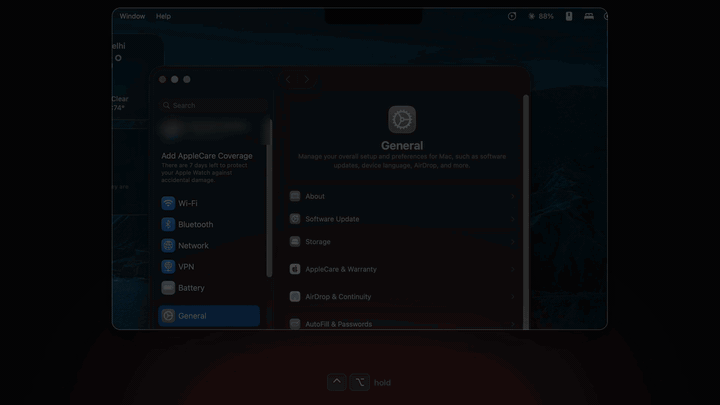
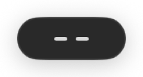

# OpenClicky

**Ask your Mac. It shows you where.** Hold ⌃ control + ⌥ option anywhere and ask out loud ("where do I
check battery health?"): a pointer flies out of the notch and lands on the answer on your screen. Hold
fn and talk, and your words are typed where your cursor is, cleaned up in the style of the app in front:
offline by default with Apple's on-device recogniser, eleven Indian languages with your Sarvam key. And
when it is more than a question, hand the task to a Codex agent. MIT licensed.

  
  
  
  
  
  

Or with Homebrew: <code>brew install --cask flowsxr/tap/openclicky</code>

  
  
  
  
  

### Try it in three steps

1. Open the dmg and click **Move to Applications** when OpenClicky offers (or drag it there). Grant
   Microphone and Accessibility when the walkthrough asks: the first hears you, the second pastes.
   Type your email when it offers a free account (no password, no key) and spoken answers and polished
   dictation work straight away; or skip it and keep everything on your Mac.
2. Hold **⌃ control + ⌥ option** anywhere and ask about what is on your screen ("where do I check
   battery health?"). The pointer flies out of the notch to the answer and tells you what to do.
3. Hold **fn** in any text box, say a sentence, let go. It is typed where your cursor is; the orb at
   the bottom of the screen shows every step. Tap fn to start a take and tap again to finish; two quick
   taps or esc discard it. Open OpenClicky (menu bar → open openclicky) for your history, the dictionary
   ("you say *aditya shatriya* → it writes **Aaditya Kshatriya**"), spoken shortcuts ("my sign-off"),
   and a style per app.

### Ask and get pointed at it

Hold **⌃ control + ⌥ option** and ask about anything on screen, tap **⌃ twice** to type instead, tap
**fn + ⌃ twice** for hands-free. The "do work" lane (files, commands, apps) additionally needs the
`openclicky` CLI and [Codex](https://github.com/openai/codex): see [Run the agent](docs/setup.md#run-the-agent).

### Dictation that stays on your Mac

Nothing leaves your Mac until you choose an engine that needs the network (Settings → engine):
**Sarvam** with your own key (Saaras hears Hindi, Tamil, Telugu, Malayalam, Kannada, Bengali, Marathi,
Gujarati, Punjabi, Odia and English, with the words appearing while you speak), or the **OpenClicky** backend with a
free account or your OpenAI key. The same key or account polishes takes with a model (punctuation, "three
p.m." → "3 PM", your style's rules) and powers **Hey Clicky**: hold fn + ⌃, say "make it formal", and
the selected text is rewritten.

### On Linux too (early)

An early Linux client, contributed by [Maya Okonkwo](https://github.com/mayaokonkwo): ask about your
screen and the pointer points, step-by-step guides, offline dictation and spoken answers, with the
same keys and the same `~/.openclicky` files as the Mac. Python and GTK 3, X11 only for now (no
Wayland). Download the `.whl` from the [latest release](https://github.com/prasanthsasikumar/openclicky/releases/latest)
and follow [OpenClicky on Linux](docs/linux.md).

### See it work

<table>
  <tr>
    <td width="50%" valign="top"> <b>record.</b> The engine banner says where your voice goes; takes land in the box when this window is in front.</td>
    <td width="50%" valign="top"> <b>history.</b> Every take with what you said and what was written; type a question and press enter to ask across them.</td>
  </tr>
  <tr>
    <td width="50%" valign="top"> <b>styles.</b> Auto-detect or pin a language, native or roman script, and the apps written in each style.</td>
    <td width="50%" valign="top"> <b>settings.</b> In the same window: General, Dictation, Keyboard, Clicky, The Orb, Privacy &amp; Security, Account, About, with a search over every setting.</td>
  </tr>
</table>

The orb rests at the bottom of the screen and shows each take: bars while listening, "moving your
words", "moved to text box". The first run happens on the island under the notch: one card per permission, then a short tour that waits for you to try each thing (dictate, ask, hand over a task):

### What dictation gives you

| | |
|---|---|
| **The orb** | a pill at the bottom of the screen: resting, listening with live bars, "moving your words", "moved to text box". Three looks, three themes, draggable, can hide when idle. |
| **Styles, app by app** | developer (code stays code), work messaging, personal messaging (lowercase, shorthand), email, other apps. Assign any app to any style; edit the rules the model reads. |
| **Dictionary & shortcuts** | names spelled your way, replaced inside any sentence; shortcuts that expand when you say exactly the trigger. Plain JSON under `~/.openclicky/dictation`. |
| **History** | every take with what you said and what was written, grouped by day, searchable, editable, on this Mac in SQLite. Incognito keeps takes out of it. |
| **Language & script** | auto-detect or pin a language; native script or roman letters for Indian languages. |
| **Installed like an app** | self-installs from the dmg, updates itself (Sparkle), opens at login if you want, frees the fn key from Emoji & Symbols with one click. |

The Mac app is derived from Farza's MIT-licensed [Clicky](https://github.com/farzaa/clicky); HeyClicky
is a separate product and this project is not affiliated with it. The dictation product shape follows
Sarvam's Kivi, studied in [docs/research/2026-10-06-kivi-reverse-engineering.md](docs/research/2026-10-06-kivi-reverse-engineering.md);
no Kivi code, art or fonts are used.

**Thank you.** To the [Sarvam AI](https://www.sarvam.ai) team behind Kivi: the way it handles dictation (one key
anywhere, a style per app, a history you can search, an orb that shows every step) taught us how dictation
on a Mac should feel, and much of OpenClicky's dictation and settings is modelled on it. To Farza, whose open
Clicky gave the app its start.

## What is inside

Modeled on the HeyClicky idea, built as a **headless agent core plus a native shell**:

- **`macos/OpenClicky`** — the native app. `Dictation/` is the take loop (the key, the engines, the
  formatter, the paste, the store), the orb, the main window and onboarding; the rest is the shell
  forked from Farza's MIT-licensed Clicky: the cursor buddy, ScreenCaptureKit capture, the
  companion shortcuts, in-process OpenAI Realtime voice, and an **Agent mode** that hands "make /
  fix / run…" requests to a Codex thread.
- **`agent/`** — a TypeScript CLI that drives the **OpenAI Codex CLI** over JSON-RPC stdio (the "do
  work" lane), plus the ask lane, a cheap gate that routes between them, screenshots, push-to-talk
  voice, an always-on `talk` loop, and thread management.
- **`backend/`** — a **Hono** API that holds every provider key, verifies **Supabase** auth, proxies
  model calls, mints Realtime voice secrets, transcribes audio, and serves the skill library. Runs on
  Node or Cloudflare Workers unchanged.
- **Skills in three layers** — 15 built-in agent skills, 17 app-teaching skills matched to the app or
  site in front of you, and your own library in `~/.openclicky/skills` (fill it from the HUD, the
  `openclicky skills` CLI, or by hand). The active set reaches both the voice model and the agent.
- **Pointing from Realtime voice** — the voice model gets a `point_at` tool, so "where is the export
  button?" flies the buddy to it while the answer is spoken, one call per step for walkthroughs.

**Your own keys need no account.** Put `openaiApiKey` (and `anthropicApiKey` for the Claude lanes —
an OpenAI key alone does not cover those) in `~/.openclicky/shell.json` and leave `token` empty: the
app and the CLI then call OpenAI and Anthropic directly, and OpenClicky's servers are not involved.
The hosted backend is only for people without keys, and the backend's own keys never leave it. See
[own keys or a free account](docs/setup.md#paying-for-model-calls-your-own-keys-or-a-free-account).

**Free accounts.** OpenClicky's hosted backend runs on a research grant, so anyone can use it for
free while the grant lasts: type your email during setup and it works at once, with a $1 starter
allowance per Mac; click the link in the email and it becomes $10 of use a month, to use as fast as you like. There are
no passwords: on another Mac you sign in with your email and a 6-digit code. Places are limited (100
confirmed accounts); when they are full, use your own key instead — that never needs an account.

Not there yet: active-document reading, connectors (Composio app connections are switched off in
0.8.0 and return in a later release), cua-driver itself (only the wiring), HeyClicky's
skill approval queue and team-shared skills, drawing/circling annotations on screen, a paywall, crash
reporting; on the dictation side, history sync between Macs, teams and a leaderboard, rich paste for
Notion / Sheets / Slack, and Wispr Flow import.

## Documentation

| Document | What |
|---|---|
| [How it works](docs/architecture.md) | the request flow end to end, repository layout, the three skill layers, following upstream HeyClicky |
| [Setup and running from source](docs/setup.md) | prerequisites, backend, CLI, macOS app, provider choices, own keys vs free accounts, auth flow, releases and the update feed |
| [Dictation design](docs/superpowers/specs/2026-10-06-dictation-kivi-port-design.md) | the take loop, engines, formatting, the space, the orb, installation — what was built and why |
| [Kivi, reverse-engineered](docs/research/2026-10-06-kivi-reverse-engineering.md) | the report the dictation product shape was taken from |
| [Dictation hand test](docs/dictation-hand-test.md) | what to try by hand after a build, step by step |
| [OpenClicky on Linux](docs/linux.md) | the early Linux client: install, shortcuts, settings, what works and what does not yet |
| [Skill authoring](docs/skills.md) | `SKILL.md` format, matching, budgets, activation |
| [`app-skills/`](app-skills/) | the 17 app-teaching skills and how to add one |
| [CONTRIBUTING.md](CONTRIBUTING.md) | setup, test commands, where help is welcome |

## Next

- Dictation: rich paste for Notion / Sheets / Slack, history sync between Macs, Wispr Flow import, a
  Windows client, Wayland for the Linux client.
- Shell (`macos/OpenClicky`): stream agent milestones onto the cursor bubble, Keychain token entry
  (upstream PR #80 is a good template), active-document reader.
- Voice: wake word, spoken task-finished summaries, Deepgram/Whisper STT fallback.
- Backend: `/agent/realtime/turn|warmup`, `/skills/activations/sync` (cross-machine activations), Composio session brokering.
- Skills: the approval queue + "My Skills" filter, team sharing, and more app skills (HeyClicky covers 89 apps).
- Pointing: drawing/circling on screen (HeyClicky's spatial context and hand-drawn annotations).
- Agent: Composio + cua-driver end-to-end once those services are configured; barge-in/always-on voice.

## License and contributing

MIT, see `LICENSE` (the Mac app is derived from Farza's MIT-licensed Clicky; HeyClicky is a separate
product). Everything here runs on your own machine with your own keys; the hosted backend is only a
convenience, free while the grant lasts. `CONTRIBUTING.md` has the setup, the test commands, and where help is
welcome. Pull requests run the TypeScript and Swift test suites in CI.
