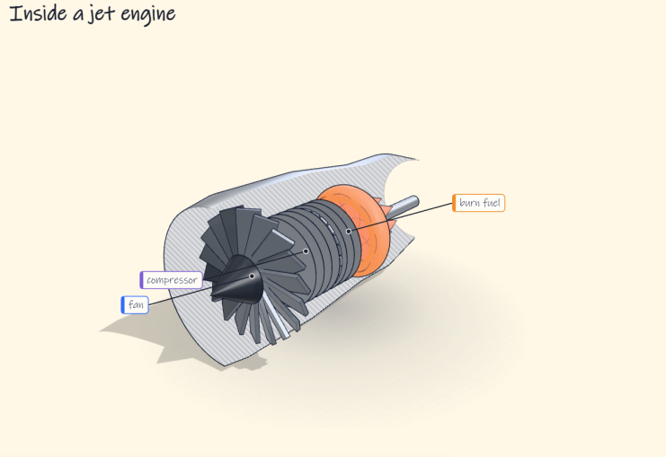
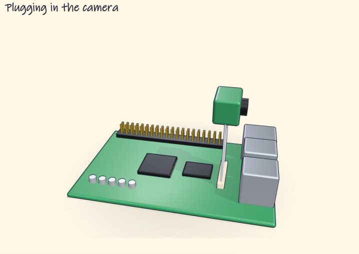
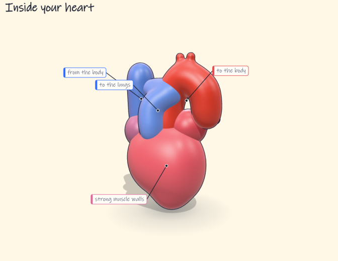
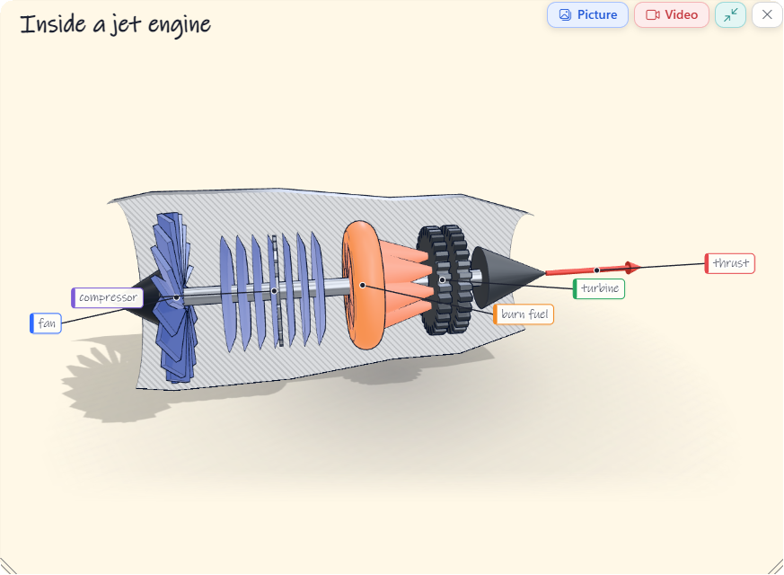

# The drawing stage (Windows)

Ask "how does this work?" about a rocket, a 3D printer, a heart, and OpenClicky answers by **drawing on your
screen while it talks**: a hand-drawn diagram that appears stroke by stroke, each beat in step with the sentence
being spoken. Machines, bodies and boards come as turning 3D models (cut open to show their inside) that you can
drag, zoom and click to ask about a part, and a real photo can sit beside the drawing. Mark part of the screen first
(the island's marker button or Ctrl+Alt+M) and the answer is about that part. Ask again while the drawing is up ("now
show it in 3D", "what does the turbine do?") and the answer builds on it. Drag the drawing by its card to move it out
of the way, and drag its corner grip (or use the wheel over it) to make it bigger or smaller. Say "save it", or click
its Picture or Video button, and it is saved as a picture, a video with its voice, or both.

This is the same kind of feature HeyClicky ships as "draw and explain". It is written from scratch for OpenClicky:
no HeyClicky code, prompts or assets are used.

| | | |
|---|---|---|
|  |  |  |

## How it works

```
 the model's answer (a small program, streamed)
        │  DrawStageController.Feed(programSoFar, done)          OpenClicky.Core/Plugins/DrawStage
        ▼
 DrawStageWindow  ── PostWebMessageAsJson ──►  Assets/DrawStage/stage.js       OpenClicky.Windows/Plugins/DrawStage
 (Win32 popup, no redirection surface,          │  finds each complete statement as the text streams in
  Windows.UI.Composition visual tree,           ▼
  WebView2 in visual-hosting mode,           stage-worker.js  runs one statement at a time → marks (plain data)
  transparent background, click-through,        │
  excluded from screenshots)                    ▼
                                             stage.js paints the marks as SVG pen strokes, each beat's strokes
                                             spread over the time its say() line is spoken
```

**The model writes a program, not a picture.** An answer is a list of beats:

```js
step(1); say("A rocket is a tall tube full of fuel, with an engine at the bottom.")
const x = W * 0.62, top = H * 0.16
rect(x, top, 90, 360, {color: 'ink', fill: 'white'})
step(2); say("The engine blasts hot gas down, and the gas pushes the rocket up.")
arrow([[x - 70, top + 270], [x - 70, top + 70]], {color: 'green'})
text(x - 85, top + 50, 'thrust', {color: 'green', align: 'end'})
```

Coordinates are in **canvas units**: the screenshot the model saw (`W` × `H`, usually 1280 wide). The page scales
the canvas onto the monitor.

**Drawing while it streams.** The page runs a statement as soon as it is complete, without waiting for the rest of
the answer. A statement ends at `;`, a line break or `}` outside brackets, strings and comments, unless the next
text continues it (`.then`, `+ 1`, `else`) or it ends mid-expression (`=`, `,`, `(`).

**Labels keep apart.** A `text()` label that would land on another label (or a card's title) moves the least it
can, up or down before sideways, to a free spot inside its card or the canvas, off the strokes drawn so far when it
can be. It keeps its place above or below the label it met, so a two-line label still reads in order, and an
`arrow()` with an end at it moves that end too. Labels draw over every stroke, so a later stroke never covers one.
`samples/labels-crowded.js` is a drawing whose labels crowd each other.

**Pacing.** Every mark belongs to the `say()` line before it. The pen draws a line's marks within that line's time,
running up to about 3× faster or 2× slower than its natural speed so they finish as the line does. There are two clocks:

- `estimate` (default): each line lasts its word count / 2.6 seconds.
- `speech`: the page sends `lineDue(k)` when line *k* is next. The app speaks it and answers `lineStarted(k)` /
  `lineEnded(k)`.

## Messages

| App → page | |
|---|---|
| `beginStream {w, h, pace, keepPlace?}` | a new program on a `w`×`h` canvas; wipes the old drawing (and where it was moved, unless `keepPlace`: a replay for a video) |
| `continueStream {pace}` | a follow-up's program, run after the one drawn: the drawing and the program's names stay |
| `feed {code, done}` | the whole program so far; `done` on the last |
| `lineStarted {k}` / `lineEnded {k}` | the voice's timing for line `k` (pace `speech`) |
| `finishNow` | draw everything still waiting, quickly (the voice was cut short) |
| `clear` | wipe the drawing |
| `remembered` | the app keeps the finished drawing: its Picture and Video buttons and its resize grip show |
| `measure` | answer with the drawing's box (`bounds`) |
| `recording {on}` | while the drawing is recorded: no caption, no buttons, no mouse, paper behind the drawing's box |
| `saving {text, state, fraction?}` | how a save is going (`working`, with how far through when known) or ended (`done`, `failed`): a bar beside the drawing |

| Page → app | |
|---|---|
| `ready` | the page loaded (earlier messages wait for this) |
| `line {k, text}` | a `say()` ran: the voice can fetch its audio now, well before it is due |
| `programRan {lines}` | every statement has run, so every line is known (the voice may finish after the last) |
| `lineDue {k, text}` | speak line `k` now (pace `speech`) |
| `finished` | the program is done and everything is drawn |
| `figures {rects}` | where the window takes the mouse: a card it can be dragged by, the 3D figures, the buttons and the grip |
| `figurePart {text}` / `save {text}` | a part of a figure was clicked / the Picture or Video button was (`text`: `picture`, `video`) |
| `close` | the drawing's close button was clicked: it goes, with its answer and any save, as with esc |
| `bounds {x, y, w, h, pageWidth, pageHeight}` | the drawing's box: its cards, photos, figures and their tags |
| `log {text}` / `error {text}` | warnings, statement errors, a stopped program |

## Answering a question by drawing (phase 1)

`CompanionManager.DrawStage` runs in the ask lane, before the Teacher's own lesson would start. A question gets a
drawing (`DrawStageLesson.WantsADrawing`) when it is one of the Teacher's teaching questions ("how does a jet engine
work"). It also gets one when it asks about the thing on the screen in a way a picture answers ("how does this
work?", "what's inside this?", "draw …"). Asking how to *do* something on screen ("how do I export this") stays
with pointing.

1. The cursor screen's screenshot is the canvas. It goes to the **answer model the person already chose** (Claude,
   OpenAI, Gemini, OpenRouter, Groq, Mistral, xAI, a plan, or the free account) with `DrawStageLesson.SystemPrompt`.
   That prompt teaches the drawing language and how a good answer is built, and allows up to 4096 output tokens.
2. `DrawingAnswer` feeds the program in the streamed reply (`DrawStageLesson.ProgramIn`: the ```js block) to the
   stage as it grows.
3. Each `line` from the page goes straight into a `SpeechQueue` in the person's answer voice. Its
   `PieceStarted` / `PieceEnded` events become `lineStarted` / `lineEnded` (pace `speech`), so each beat is drawn
   while its sentence is heard. `programRan` finishes the queue after the last line.
4. If the reply holds no program, or the stage cannot start, the question goes back to the normal ask lane
   before anything is said. With the stage on, the Teacher's own handwriting board is not used: the questions it would
   teach go to the stage, the ask lane doesn't offer its tools, and a fast-voice call to its draw tool is drawn on the
   stage instead, so every drawing can be moved, saved, shrunk and closed the same way. The words that send a question
   here are only a first guess: the model may reply `NONE`
   when a picture wouldn't help ("explain this error"), and the hold line ("One moment, let me draw that for you")
   waits until the reply is a program, so it never promises a drawing that doesn't come. If the voice fails partway,
   the stage draws the rest at once and the system voice reads what was left.
5. Esc and the next question clear the stage (`TeacherPlugin.ClearBoard`). The stage's browser starts as soon as
   the talk key goes down (`DrawStageController.Prepare`), so the first drawing does not wait for it.

Drawings can come from a different model than answers. Under Settings → Clicky → Models, "Drawings come from" sets
`drawingSource` and `drawingModel` in shell.json (`DrawStageLesson.WriterFor`). The same section turns on your own
models: Ollama, LM Studio, or any OpenAI-compatible server. Each is reached at its address, needs no key, and its
models are read from `/v1/models` (`LocalModels`). When no model is picked, it uses the first one that sees images.

It is on whenever the Teacher plugin is on. To turn it off, set the preference `teacher.drawingStage` to `false`;
teaching questions then go back to the Teacher's board. The fast (Realtime) voice lane still uses the Teacher's
board.

## The drawing language (phase 1 subset)

| Call | Draws |
|---|---|
| `step(n)`, `say(text)` | a beat and its spoken line |
| `line(points, o)`, `curve(points, o)` | a pen stroke through `[[x, y], …]`; `curve` is smooth |
| `arrow(points, o)` | a stroke with a head at its last point |
| `circle(x, y, r, o)`, `ellipse(x, y, rx, ry, o)`, `rect(x, y, w, h, o)`, `poly(points, o)` | outlines, optionally filled |
| `dot(x, y, r, o)`, `text(x, y, words, o)`, `highlight(x, y, w, h, o)` | a point, handwriting, a marker sweep |
| `card(x, y, w, h, {title})` | a paper card to explain on |
| `photo(x, y, w, h, {query, caption})` | a real photo from Wikimedia Commons (found by the app) in a polaroid frame |
| `figure(x, y, w, h, {tilt, turn, zoom, spin, ground})` | a turning 3D stage; its parts are below |
| `chart(x, y, w, h, o)`, `timeline(x, y, w, o)` | a graph or a timeline placed by value; below |
| `W`, `H`, `sin`, `cos`, `exp`, `log`, `PI`, `mid`, `along`, `polar`, `lerp`, `range` | the canvas and helpers |

Options `o`: `color` (`ink, blue, red, green, orange, purple, pink, yellow, teal, brown, grey, white` or `#hex`),
`width`, `fill`, `fillOpacity`, `dashed`, `size`, `align` (`start`, `middle`, `end`), `bold`.

### Graphs and timelines

`chart()` and `timeline()` are drawn with the marks above, but take values instead of canvas units, so the scale is
right without the model working out every coordinate (`stage-worker.js`, nothing new on the page).

| Call | Draws |
|---|---|
| `chart(x, y, w, h, {x, y, grid, color})` | axes with numbered ticks in that box. Each axis is `{from, to, step, label, format}` (`step` is optional: about one number per 50-80 units), or `{labels: [...]}` for named columns. They cross at zero when zero is on them |
| `g.line(data, o)`, `g.area(data, o)` | a line (or the shaded space under it) through `[[x, y], …]`, numbers (one per column) or a function of x; cut where it leaves the axes. `{dots: true}` marks each point |
| `g.bars(values, o)` | a bar per value (`{colors, values: true, barWidth}`) |
| `g.dot(x, y, {label})`, `g.label(x, y, words, o)`, `g.hline(y, words, o)`, `g.vline(x, words, o)` | a point, a note, a dashed line across at a value |
| `g.at(x, y)`, `g.x(v)`, `g.y(v)` | canvas units of a value, for the model's own marks |
| `timeline(x, y, w, {from, to, step, label, format})` | a line of years across at height `y` |
| `t.event(when, words, o)`, `t.span(from, to, words, o)`, `t.at(when)` | a dot with its label on a stem, a band for a stretch of time, a value's point |

Each axis is one stroke, its tick nubs on it. A chart's own labels (a dot's, a dashed line's) take the spot around
their point that crosses the fewest of its strokes and labels. A timeline's labels go on stems: the shortest stem,
above or below, where the label touches no other and no stem runs through it, centred on its stem or ending at it.
Samples: `chart-falling-ball.js`, `chart-bars-water.js`, `timeline-flight.js`.

### 3D figures

| Part | Shape |
|---|---|
| `f.box({w, h, d, round})` | a box; `round` rounds its edges and corners |
| `f.cyl({r, h, r2, open})`, `f.cone({r, h})`, `f.sphere({r})`, `f.torus({r, tube})`, `f.capsule({r, h})` | the round solids |
| `f.lathe({points: [[radius, y], …]})` | a turned profile: casings, nozzles, bottles |
| `f.extrude({points, depth, holes, bevel})` | a flat outline made thick: wings, fins, brackets |
| `f.tube({points, r})`, `f.pipe({points, r, bend})` | a smooth tube; a pipe with straight runs and bends |
| `f.spring({r, h, coils, wire})`, `f.gear({r, teeth, depth})`, `f.arrow({from, to, color})` | |
| `f.blob({balls, sticks, paths, holes, smooth})` | one smooth organic surface over balls, (tapering) sticks and paths, blended where they meet: organs, animals, leaves (a distance field meshed with surface nets) |

Every part takes `at`, `rot`, `axis`, `scale`, `parent`, `color`, `opacity` and a material: `steel, alu, titanium,
chrome, iron, gold, copper, brass, plastic:<color>, paint:<color>, rubber, wood, stone, ceramic, glass, water,
glow:<color>`, and the organic `tissue, muscle, skin, bone, leaf, fabric, pcb`. `cut: 'z'` takes the front half
away (a hatched cut face shows where), `copies: {n, step}` makes a row, `around: {n, axis, center}` repeats the part
round an axis, `mirror: 'x'` adds its mirror image. Motion: `.spin .stroke .bob .pulse .orbit .move`; labels:
`part.label(words, {color})`; camera: `f.view({tilt, turn, zoom})`. A part named by its const (`const liftFan =
f.cyl(…)`) is asked about as "lift fan" when clicked.

Dragging a figure turns it any way round, all the way over (it stops swaying where it was); the wheel zooms.

How much a drawing shows is set in Settings → Clicky → Drawings: **How detailed** (simple: 8-15 parts and 3-4 beats;
detailed: 15-40 parts; very detailed: 30-70 parts and up to 7 beats, with 16,000 tokens to write them) and **Your
drawing instructions**, which are added to the end of every drawing's prompt (a style, a level, what to show more of).

The look: soft key light with shadows on an invisible ground, a rim light behind, an ink outline round every part
and lighter lines on its sharp edges, and labels as small tags on leader lines
that keep to their side and their order while the figure sways. The camera fits the figure's box.
When the first spoken line is slow to come, "One moment, let me draw that for you." is said first.

## 3D pieces made apart

A complex real thing (a plane, a car, an animal) is built from pieces, like a model kit: the drawing model lays it out
as 3 to 8 pieces (`f.piece({make, of, size, at, rot, mirror, …})`: an F-35's fuselage, wing, tail fins, canopy and
nozzle), and each piece is made on its own while the voice talks (`pieceWanted` → `piece`). It shows as a faint box of
its size at once and fills in when it arrives; then it is a part like any other: labelled, clicked, cut, mirrored. The
same piece is made once (`PieceWorkshop`), a few at a time.

Who makes them (Settings → Clicky → Drawings → 3D pieces come from, `PieceMakers`):

| Maker | Needs | Sends |
|---|---|---|
| Your drawing model | any answer source; best with a strong one | parts of the figure language (JSON), stretched to fill the piece's box |
| LLaMA-Mesh in Ollama or LM Studio | about 5 GB (Q4) to 9 GB (Q8): `ollama pull hf.co/bartowski/LLaMA-Mesh-GGUF:Q8_0` | an OBJ mesh |
| Hunyuan3D-2 server (`api_server.py`) | 6 GB for shapes, 16-24 GB with textures | a GLB, from a picture made by OpenAI's image model when there is an OpenAI key, else from the words |

Settings reads the graphics card's memory (`GraphicsCards`) and suggests a maker for its grade: low (under 6 GB), medium
(6-15 GB) or high (16 GB and up). A maker on another PC is reached by its address. A maker that fails hands the piece to
the drawing model; one that can't be made at all becomes a solid box of the piece's size. Pieces are offered to the model
when a maker is set up, or when drawings are very detailed. The page reads GLB files itself (meshes, node placement,
colours, textures; not Draco-compressed ones) and OBJ meshes (inward-wound ones are turned outward).

## Follow-up questions

A finished drawing stays up, and the stage remembers it (`DrawStageController.Current`: its questions, its whole
program, its screen, and each spoken line with how long it took and its audio). A new question holds it instead of
clearing it. When the question may be about it (`DrawStageLesson.MayBeAFollowUp`: one a picture answers, or one that
asks for more of the drawing, another view, a part of it), the model gets the drawing's program
(`DrawStageLesson.FollowUpPrompt`) and answers one of three ways:

- **Add to it**: the program starts with `keep()` and has only the new beats. The stage gets `continueStream`, and the
  new statements run in the same worker after the old ones, so `c`, `f` and the parts are still there to label, move or
  turn to (`f.view`). `DrawingAnswer` waits for the program's first statement before choosing.
- **Draw it afresh**, another way ("now in 3D", a cutaway, simpler): a new program, as for a new question.
- **`NONE`**: it isn't about the drawing. The drawing goes, and the question is answered as usual.

A question that can't be about it (opening an app, small talk, a question for the agent) clears it first.

## Saving a drawing

"Save it" (`DrawStageLesson.SaveRequestKind`) or the Picture and Video buttons in the drawing's corner save the
drawing up to `Videos\OpenClicky` (`DrawingRecorder`). "Save the picture" or the Picture button saves only the PNG;
"save the video" or the Video button only the MP4; "save it" both.

- **a PNG** of the drawing as it is, cut to its box: its cards, photos, 3D figures and their tags, on paper. Marks that
  point at the real screen outside the card, and the screen itself, are never in it.
- **an MP4** of it being drawn, with its voice. The stage draws it once more on screen, each line started and ended on
  the clock it was first spoken on, while WebView2 captures the page (about 15 frames a second); each line's audio is
  placed where its line starts. `DrawingVideo` writes H.264 and AAC with Media Foundation's sink writer (it ships with
  Windows) through NAudio's bindings. While it records, the page shows no caption or button, takes no mouse, and puts
  paper behind the drawing's box.

A drawing about 40 seconds long takes about as long to save. A bar beside the drawing (below it, above it or to one
side, so it stays out of the video) shows how far it is; the buttons wait meanwhile. A new question or esc stops a save;
Explorer opens on the file when it is done.

## Moving and resizing a drawing



A drawing on a card (or a photo) sits on a board (`#board`) the page moves and scales as one, 3D figures and their
tags included. Drag the card to move it (a part of it always stays on screen); drag a grip in either bottom corner
(there from its first stroke), or turn the wheel over it, to make it bigger or smaller (0.35× to 3×). Its PiP button
shrinks it into the screen's bottom-right corner, like a video player's, and brings it back; a save records it at the
size it was. The close button (there from the first stroke, on any drawing) takes it away as esc does. The 3D figures render with more pixels when it
is bigger, so they stay sharp. While there is a card the stage window takes the mouse over it (the page reports the
card's box with the figures'), so the card can be grabbed even while it is still being drawn; marks drawn straight
over the screen (pointing at what is under them) are never movable. A new drawing goes where it is drawn; a replay for
a video keeps it where it was moved.

## Marking part of the screen

The island's marker button (or Ctrl+Alt+M) dims the screen under the pointer a little and lets you draw a loop with a
yellow marker round some code, part of a photo or a chart. The mark stays while the next question is answered: the
question carries where it is and a close-up of it, and a drawing answer is made on that screen so it can point at it.
A mark nobody asks about goes after three minutes. Esc takes one thing at a time: a drawing (or an answer) first, then
on the next press the mark. `--openclicky-marker-smoke` draws one by itself.

Ctrl+Alt+M is held only while drawn answers are on (the Teacher plugin and its drawing stage), so otherwise the keys
stay the other apps' (Word inserts a comment with them). Settings → Clicky → Drawings → "Mark the screen with" picks
Ctrl+Alt+M, Ctrl+Alt+Shift+M or none (`markerShortcut` in shell.json); the island's marker button always works.

## Drawing in Urdu (and other languages)

A drawing speaks and writes in the language Clicky answers in (Settings → Clicky → Language, `ReplyLanguage`): the
prompt asks for every `say()` line, `text()`, title and caption in it, in its own script, while the program stays
English. Urdu and other Arabic-script words are drawn in "Clicky Script", a face that covers only those letters, so
English words around them keep the handwriting font:

- by default the bundled **Noto Nastaliq Urdu** (`vendor/fonts`, SIL Open Font License);
- "Windows' own" (Segoe UI), or **a font on this PC** by its name, such as IndoPak Nastaleeq or Jameel Noori Nastaleeq
  if installed: Settings → Clicky → Drawings → "Urdu in drawings" (`drawingScriptFont` in shell.json: unset, `system`,
  or the font's name). Fonts with no clear licence are not bundled, only used from the PC.

Right-to-left text is laid out right to left (mixed Urdu and English lines read in order), keeps the place the program
gave it (start and end swap), and writes itself in from the right; an Urdu card title starts at the card's right. The
caption follows the line's own direction. `--language ur` on the smoke asks a lesson in Urdu whatever Settings say.

Gemini says the lines in Urdu without an English accent when it is the voice (a Gemini key; Settings → Clicky → Talking
→ "Gemini voice" picks one of its 30 voices, and the fast voice on Gemini uses it too). This PC's engines don't hear
Urdu, so with an account or the offline engine Gemini writes down what was said, Urdu in Urdu script and English words
in English letters (`GeminiAudioTranscriptionProvider`, falling back to its lighter model when busy).

## Safety

The program is model-written code, so:

- It runs in a **Web Worker**, never in the page. The worker has no DOM. Before any program runs, `fetch`,
  `XMLHttpRequest`, `WebSocket`, `importScripts`, `Worker`, `SharedWorker`, `Blob`, `URL.createObjectURL` and similar
  are fixed to `undefined` so they can't be put back (a nested worker would otherwise get a fresh global with `fetch`);
  if any of them can't be, the worker runs no program at all.
- The worker's script is served with its own Content-Security-Policy (`default-src 'none'; script-src 'unsafe-eval';
  worker-src 'none'; connect-src 'none'`): a worker follows its own response's policy, not the page's `<meta>`. That
  also stops `import()` of an address.
- The page's Content-Security-Policy allows no network at all (`connect-src 'none'`). Its files (the html, scripts
  and styles under `Assets/DrawStage`, nothing else) are served from the app folder by the window's own request
  handler, and it cannot navigate anywhere else or open windows.
- If the page never loads (no WebView2, a failed navigation), the question is answered in words within 10 seconds
  of the program being written; a program that says nothing is not drawn either.
- A hidden stage gets no frames, and the page asks for none while nothing is drawn.
- Each statement has 2 seconds to run, or the program is stopped. A program may draw at most 2000 marks.
  `random()` is fixed, so a program draws the same picture every time.
- The stage is click-through and kept out of screenshots, so the next question's screenshot sees the screen,
  not the drawing.

## Why WebView2 + SVG (and three.js for 3D)

- **The window:** a WebView2 control inside a transparent WPF window draws nothing, and in an opaque one it covers
  the screen. So the stage is a plain Win32 popup (`WS_EX_NOREDIRECTIONBITMAP`, layered + transparent for
  click-through) whose content is a Windows.UI.Composition visual. WebView2 renders into that visual in
  visual-hosting mode, so the page's alpha reaches the desktop.
- **3D (phase 2): three.js over Filament.** Both are excellent. three.js runs in the same page as the 2D drawing,
  and the same engine page can later run unchanged in the Android/iOS WebViews and on Linux. It also has the
  procedural geometry a model needs to build a machine from parts (lathe, tube, extrude, gears made from
  shapes). Filament is a native C++ PBR renderer built for glTF assets. It would need its own bindings on every
  platform and a mesh pipeline for model-built parts.

## Phases

| Phase | |
|---|---|
| 0 ✓ | the stage window, the message bridge, the page with streaming execution, the worker sandbox, the pen, captions and both pacing clocks; `--openclicky-drawstage-smoke` |
| **1 (this)** | questions answered by drawing in the ask lane, with any answer model; the drawing prompt; the screenshot as the canvas; speech pacing from `SpeechQueue`; falling back to words |
| 1.x | the Realtime voice lane; a Settings switch; a model-callable tool for questions the heuristic misses |
| 2 ✓ | `figure()` 3D figures with three.js r172 (`figure3d.js`, `vendor/three`): box, cyl, cone, sphere, torus, capsule, tube, lathe, extrude, spring, gear, arrow; real materials; parts growing in on their line; labels that follow their part; spin, stroke, bob, pulse, orbit, move |
| 2.x ✓ | drag to turn, wheel to zoom, click a part → ask about it; cutaways, copies, mirror, rounded boxes, pipes, organic blobs; the studio look (shadows, outlines, rim light, tags); a hold line; marking part of the screen |
| 3 | photo cards ✓, follow-up questions that add to the drawing ✓, graphs and timelines ✓, molecules |
| 4 | lessons: saving as a picture and a video with its voice ✓, quiz cards |

## Trying it

```powershell
cd windows
dotnet build OpenClicky.Windows.sln
.\src\OpenClicky.Windows\bin\Debug\net8.0-windows10.0.19041.0\OpenClicky.exe --openclicky-drawstage-smoke
.\src\OpenClicky.Windows\bin\Debug\net8.0-windows10.0.19041.0\OpenClicky.exe --openclicky-drawstage-smoke my-program.js --speech --shot stage.png
# the 3D samples: samples\heart-blob-3d.js, samples\jet-engine-cutaway-3d.js, samples\board-3d.js, samples\rocket-engine-3d.js, samples\heart-photo-3d.js
.\src\OpenClicky.Windows\bin\Debug\net8.0-windows10.0.19041.0\OpenClicky.exe --openclicky-drawstage-smoke src\OpenClicky.Windows\Assets\DrawStage\samples\jet-engine-cutaway-3d.js
# a whole drawing answer on a screenshot of your screen: a written reply, or your answer model's own (needs a key)
.\src\OpenClicky.Windows\bin\Debug\net8.0-windows10.0.19041.0\OpenClicky.exe --openclicky-drawstage-smoke reply:src\OpenClicky.Windows\Assets\DrawStage\samples\heart-reply.md --voice
.\src\OpenClicky.Windows\bin\Debug\net8.0-windows10.0.19041.0\OpenClicky.exe --openclicky-drawstage-smoke "lesson:how does a jet engine work?" --voice
# a follow-up that adds to the drawing, then saving it (a PNG and an MP4 in Videos\OpenClicky)
.\src\OpenClicky.Windows\bin\Debug\net8.0-windows10.0.19041.0\OpenClicky.exe --openclicky-drawstage-smoke reply:src\OpenClicky.Windows\Assets\DrawStage\samples\jet-engine-cutaway-3d.js --then reply:src\OpenClicky.Windows\Assets\DrawStage\samples\jet-engine-followup-reply.md --voice --save
```

Set `OPENCLICKY_DRAWSTAGE_DEVTOOLS=1` to allow the page's dev tools and context menu. To preview the page in an
ordinary browser, serve `Assets/DrawStage` over http and call
`drawStage.handle({type: 'beginStream', w: 1280, h: 720})`, then `drawStage.handle({type: 'feed', code, done: true})`.
