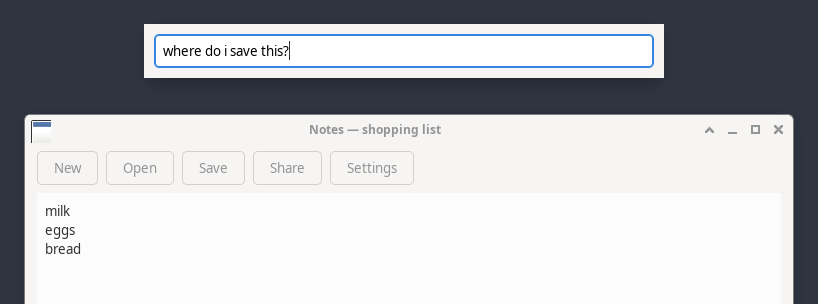
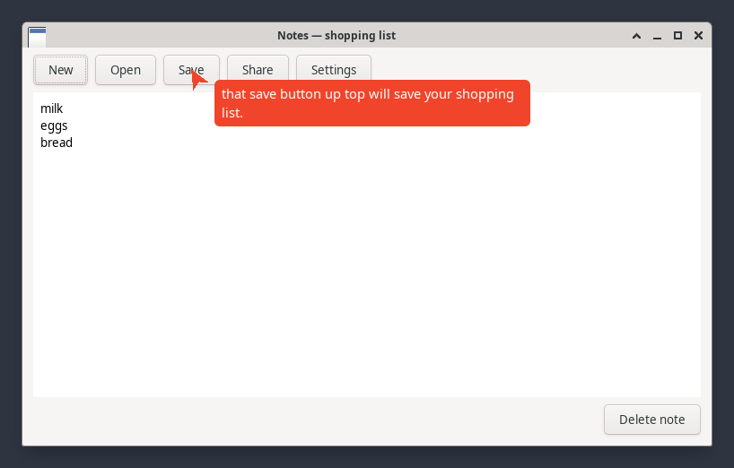
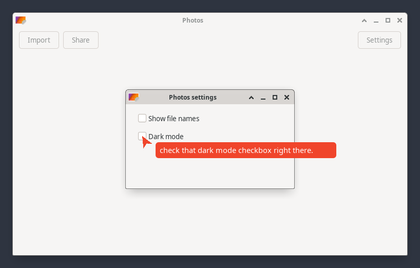
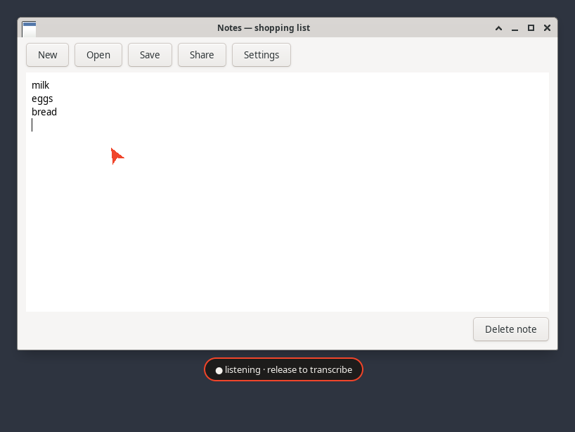
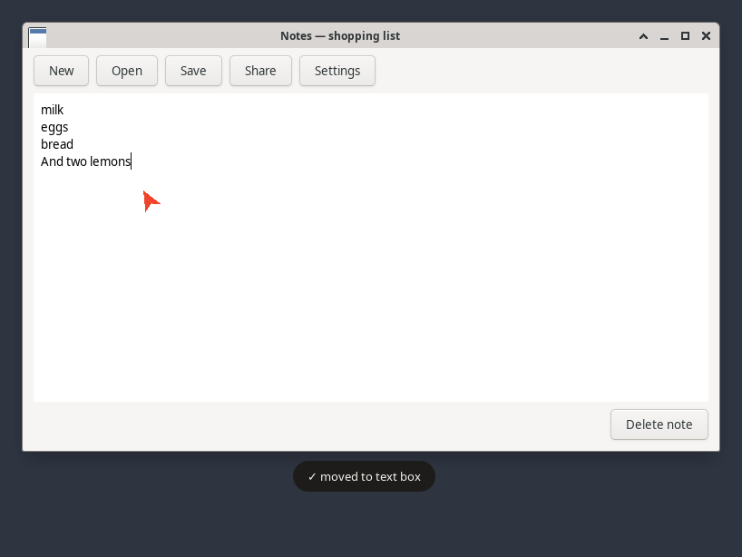
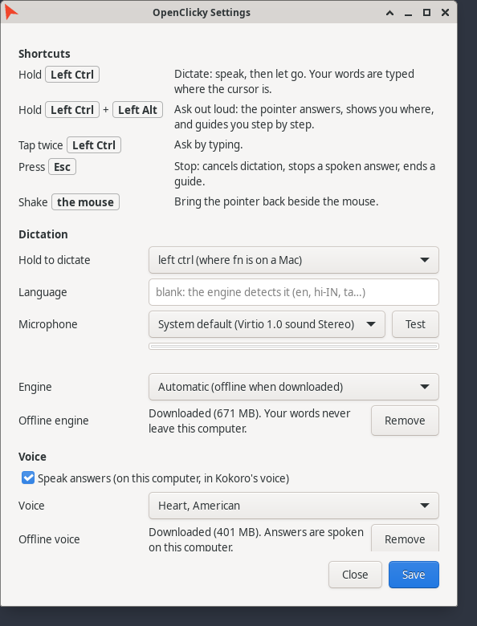

# OpenClicky on Linux

An early Linux client for OpenClicky. It runs against the same backend contract and reads the same
`~/.openclicky` files as the Mac app, but is its own small program: Python and GTK 3 on X11, under
[`linux/`](../linux). Everything in the main README is about the Mac app; this page is the Linux one.

What it does today: **ask about your screen** by typing or out loud (the pointer answers and
points), **step by step guidance**, **the pointer** itself (including shake to appear), **dictation** (untested with a
real microphone so far), **spoken answers**, **Settings** and a **tray icon**. Not yet: Wayland.

## Ask about your screen

Tap **left ctrl twice**. A one-line box opens at the top of the screen:



Press **Enter**. The box closes, a screenshot of your screen goes with the question, and the orange
pointer beside your mouse says "thinking…". With more than one monitor, each one goes as its own
picture, the one with your mouse first, and the pointer can fly to another monitor when that is
where the answer is. When the answer is about something on screen, the
pointer flies to it and types the answer beside itself:



*A real answer (Claude Sonnet 4.6 through OpenRouter) about the window on screen; the pointer's tip
is on the Save button the answer names.* A question that is not about the screen ("what is the
capital of france?") is answered by the mouse without pointing. **Esc** dismisses an answer and the
pointer comes back to the mouse. Follow-ups remember the last ten exchanges.

## Ask out loud

Hold **left ctrl + left alt** (the Mac's control + option), ask your question, let go. It is
transcribed (offline, when the offline engine is downloaded) and answered exactly like a typed
question: the pointer flies to what it is about, types the answer beside itself, and guides you step
by step. Adding left alt while you are already dictating turns that take into a question.

**Answers are spoken**, on this computer, in Kokoro's voice: the Mac app's offline voice, with its
speakers (Heart by default). Settings → Voice → Offline voice → **Download** (about 350 MB, once);
**Speak answers** switches it off, **Voice** picks the speaker. The first sentence starts as soon as it
is ready; **Esc** or a new question stops it.

## Step by step

Ask how to do something that takes several steps ("how do i turn on dark mode?") and you get one
step at a time: the pointer shows the first one and waits. Do it — a click, or Return or Tab after
typing — and a moment later, once the menu or dialog has opened, OpenClicky looks at your screen
again and shows the next step, until the last one:



*The second step of a real guide: the first ("open settings first.") pointed at the Settings button,
whose click opened this dialog.* If you click something else, the next step helps you back. **Esc**,
a new question, two minutes without a click, or fifteen steps end the guide. Steps work the way they
do in the Mac app.

## The pointer

A small orange triangle that follows the mouse, a little below and to the right of it. Clicks go
straight through it, and it never takes the keyboard. **Settings → Show the pointer** decides when it
shows while it is following you; while it is answering or pointing it always shows.

| Show the pointer | What it does |
|---|---|
| always, beside the mouse | The default. |
| while the mouse moves | Fades away once the mouse has rested for 3 seconds; any movement brings it back. |
| after a shake | Out of sight until you **shake the mouse** quickly side to side, then it follows until the mouse rests. An ordinary back-and-forth never counts (four quick turns of at least 60 px are needed, as on the Mac). |
| only while answering | Out of sight until an answer shows. |

## Dictate

Hold **left ctrl** on its own, speak, let go: it is where fn is on a Mac keyboard. (Ctrl shortcuts
such as ctrl+C still work as always: dictation only starts once ctrl has been held alone for a third
of a second.) The orb at the bottom of the screen shows what is happening:



Your words are cleaned up the way the Mac app cleans them (fillers such as "um" removed, your
dictionary and spoken shortcuts from `~/.openclicky/dictation/`, a capital at the start of each
sentence) and typed where your cursor is:



*Taken with a stand-in microphone that "heard" "um, and two lemons": dictation has not yet been
tried with a real microphone.*

| Do | Get |
|---|---|
| Hold left ctrl, speak, let go | The words are typed into the window in front |
| Hold left ctrl + left alt, speak, let go | A question for the pointer (see below), nothing typed |
| Esc while it listens | Cancel |
| Left ctrl + another key | A shortcut, not dictation: nothing is typed |

Another dictation key (Settings → Hold to dictate: right ctrl, right alt, right super or the menu
key) listens at once, and can also be tapped to start and tapped again to finish.

The words go only into the window that was in front when you pressed the key. If another window is
in front by the time they are ready, they are put on the clipboard instead ("copied, press ctrl+v").
Terminals get ctrl+shift+v. Your own clipboard text is put back afterwards.

## Settings

From the tray icon (**Settings…**), or `openclicky-linux settings`:



**Shortcuts**, at the top, lists every key combination and what it does, for the dictation key you
picked. *Shown with an example key, not a real one.* **Microphone** lists every input your sound system
knows (a headset plugged in since shows up next time Settings opens); **Test** records three
seconds with a level meter and says whether it heard you, keeping nothing. Below the fields it says
where dictation and answers will go, as you type. **Save** writes into `~/.openclicky/shell.json`, the file the Mac app and the
CLI read, and leaves everything else in it alone; the file stays readable by you only.

**Offline dictation, no key needed:** Settings → Dictation → Offline engine → **Download** (about
490 MB, once). It is Parakeet, the open speech model the Mac app uses offline, running on your own
computer: your words never leave it. 25 European languages, English included, with punctuation.
**Engine** chooses where dictation goes: Automatic (offline once it is downloaded, else a key or an
account), or always offline, OpenAI or your account.

| You add | Answers come from | Dictation goes to (when Engine is Automatic and offline is not downloaded) |
|---|---|---|
| an Anthropic key | Anthropic (Claude Sonnet 4.6) | — |
| an OpenRouter key | OpenRouter (Claude Sonnet 4.6, or `answerModels.openrouter`) | — |
| an OpenAI key | OpenAI (GPT-4.1) | OpenAI (`gpt-4o-mini-transcribe`) |
| an OpenClicky account token | the OpenClicky backend (`/chat`) | the OpenClicky backend (`/agent/transcribe`) |

With several, answers use the first in that order, as the Mac app does. Your own keys go straight
to their company and never to the OpenClicky backend.

**Start OpenClicky when I log in** adds it to your desktop's autostart (`~/.config/autostart`). A key
set in an environment variable (`OPENCLICKY_OPENROUTER_KEY` and the like) wins over Settings while it
is set; Settings says so, and never copies it into the file.

## Install

You need an **X11 session** (at the login screen, pick the session called "Xorg" or "X11" rather
than "Wayland"). Wayland does not let an app watch a key, type into another app or float a window
over it; on Wayland OpenClicky says so and stops.

1. From your distribution: Python 3.10+, GTK 3 bindings and a recorder.
   - Debian, Ubuntu: `sudo apt install python3-venv python3-gi gir1.2-gtk-3.0 pulseaudio-utils`
   - Fedora: `sudo dnf install python3-gobject gtk3 pulseaudio-utils`
2. Download the `openclicky_linux-…-py3-none-any.whl` file from the
   [latest release](https://github.com/prasanthsasikumar/openclicky/releases/latest), then:

   ```bash
   python3 -m venv --system-site-packages ~/.local/openclicky
   ~/.local/openclicky/bin/pip install ./openclicky_linux-*-py3-none-any.whl
   ~/.local/openclicky/bin/pip install sherpa-onnx==1.13.8   # for offline dictation (about 30 MB)
   ~/.local/openclicky/bin/openclicky-linux settings   # add a key, then Save
   ~/.local/openclicky/bin/openclicky-linux --check    # what it found
   ~/.local/openclicky/bin/openclicky-linux
   ```

   From a clone instead: `cd linux && python3 -m venv --system-site-packages .venv && .venv/bin/pip install -e .`

`--system-site-packages` lets the program use your distribution's GTK. Ctrl+C in the terminal, or
**Quit** in the tray menu, stops it. The tray icon needs a system tray (Xfce, KDE, MATE and Cinnamon
have one; GNOME needs an extension); without one, the shortcuts still work and Settings opens with
`openclicky-linux settings`.

## Privacy

- A question sends a screenshot of **every monitor** to whoever answers it (on an OpenClicky
  account, the two nearest your mouse): keep anything private out of sight before you ask.
- Spoken answers are made on this computer: nothing is sent to be spoken.
- Dictation with the offline engine sends nothing anywhere. With a key or an account, it sends only
  the audio recorded while you hold the key.
- Nothing is recorded or sent otherwise: the watcher only notices key presses and clicks (it acts on
  clicks only while a guide waits for a step), and the pointer only reads where your mouse is.
- A guide sends a fresh screenshot after each step you do, until it ends.
- Keys live in `~/.openclicky/shell.json`, readable by your user only.
- Your own pointer and captions are hidden while a screenshot is taken, so they never cover what you
  asked about.

## When something does not work

| You see | Try |
|---|---|
| "needs an X11 session" | Log out and pick the Xorg / X11 session. |
| "asking needs an anthropic, openrouter or openai key…" | Add a key in Settings. |
| "no microphone recorder found" | Install `pulseaudio-utils` (or `alsa-utils`). |
| "dictation needs an engine" | Settings → Dictation → Offline engine → Download, or add an OpenAI key or a token. |
| "didn't catch that" every time | Settings → Microphone → **Test**. "Heard nothing at all": pick another microphone, or unmute it in your sound settings; in a virtual machine, the host must pass the microphone through. |
| The pointer never shows | Settings → Show the pointer: "after a shake" and "only while answering" keep it hidden on purpose. |
| Left ctrl twice does nothing | Tap, don't hold, and press nothing in between: ctrl+C never counts. |

`openclicky-linux --check` prints what it found: the key, the recorder, where dictation and answers
go, the language and the pointer setting. What happened, and how long it took, is in
`~/.local/state/openclicky/app.log` (never your words, questions, answers or keys).

## For developers

How it is built, which Mac file each part follows, and how to run the tests (they start their own
private X display, so they never touch yours): [`linux/README.md`](../linux/README.md). The pictures
on this page are made by `linux/scripts/make-doc-screenshots.sh`.
